  

  
  
  

  <b>Профиль компетенций студента, который собирается из его цифрового следа, а не из разовых анкет.</b> 
  Команда №36, ЮГУ · акселератор «Окно в рынок для стартапа» · заказчик: Фонд Югры

  <a href="https://shortcuts-atlantic-necessarily-shops.trycloudflare.com/"><b>▶ Открыть прототип</b></a> 
  Адрес временный. Актуальная ссылка будет здесь же.

---

## Что это

Студент получает профиль из восьми компетенций и пяти уровней. Профиль складывается из учёбы, проектов, мероприятий, кейсов, волонтёрства и курсов. Куратор видит группы и статусы. Администрация вуза получает сводку по направлениям.

Ключевые экраны:

| | |
|---|---|
|  |  |
| Студенты по направлениям | Теплокарта компетенций |
|  |  |
| Профиль студента | Панель куратора |
|  |  |
| Опрос самооценки | Центр согласий |
|  |  |
| Паспорт компетенций с QR | Калькулятор окупаемости |

Все данные на скриншотах вымышленные.

## Статус

Работающий веб-прототип на демонстрационных данных. Реальных студентов и реальных источников данных пока нет. Пилот запланирован на одном направлении ЮГУ.

## Исходный код

Закрыт. Проект разрабатывается командой и не публикуется в открытом доступе. Все права защищены. Копирование, изменение и распространение без письменного разрешения не допускаются.

Разработка прототипа выполнена внешним разработчиком по приглашению Д. Хвостовой.
