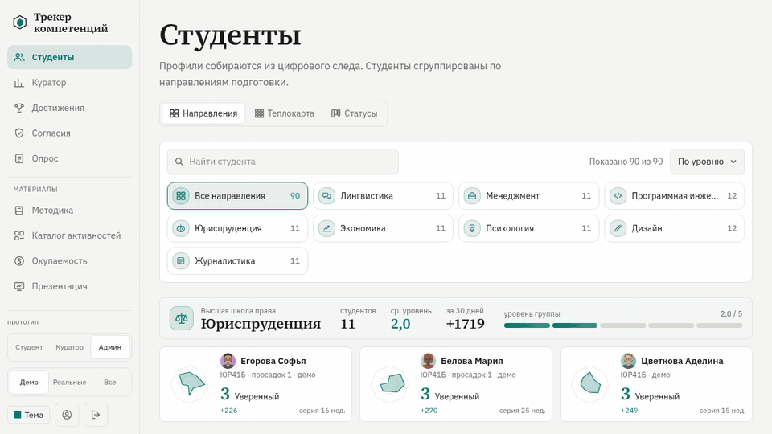
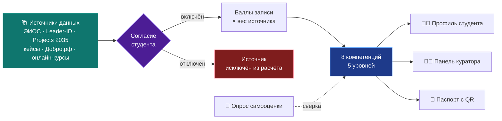
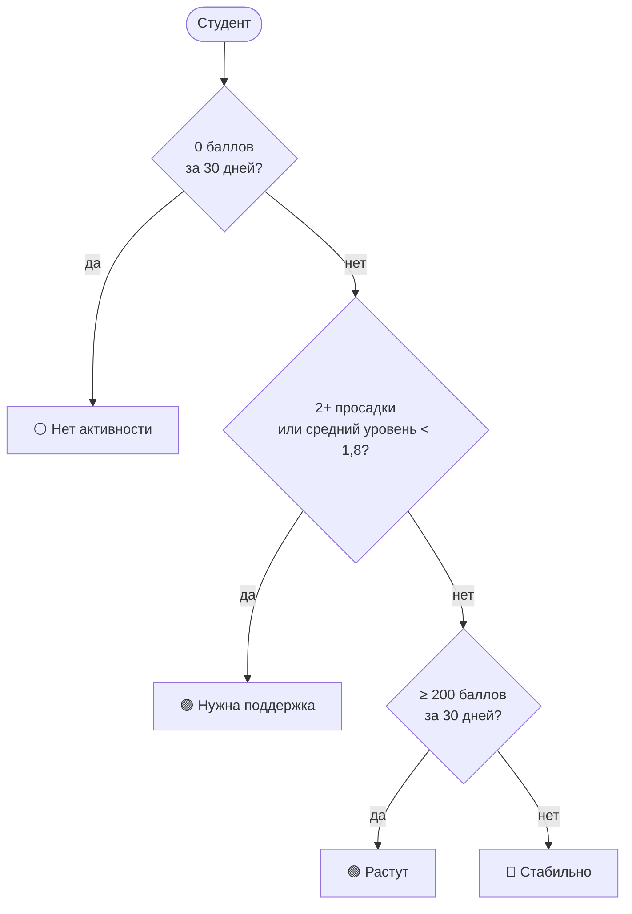

<p align="center">
  
</p>

<p align="center">
  
  
  
</p>

<p align="center">
  
  
  
  
  
  
</p>

<p align="center">
  <b>Система трекинга мягких и профессиональных компетенций студентов на основе цифрового следа.</b><br>
  Команда №36, ЮГУ · акселератор «Окно в рынок для стартапа» · заказчик: Фонд Югры<br>
  <sub>Разработка прототипа выполнена внешним разработчиком по приглашению Д. Хвостовой.</sub>
</p>


## Навигация

| | | |
|---|---|---|
| 🎯 [Зачем это нужно](#зачем-это-нужно) | 🎬 [В движении](#в-движении) | ⚙️ [Как это работает](#как-это-работает) |
| 🖼️ [Скриншоты](#скриншоты) | 🧩 [Возможности](#возможности) | 🛠️ [Стек](#стек) |
| 🚀 [Запуск](#запуск) | 🗂️ [Структура](#структура) | 🧭 [Дорожная карта](#дорожная-карта) |
| ⚠️ [Ограничения](#ограничения) | 🔐 [Лицензия](#лицензия) | |


## Зачем это нужно

> Данные о развитии студента разбросаны по системам вуза, а подтвердить мягкие навыки работодателю и самому студенту нечем.

| 😕 Проблема | 💡 Что делает трекер | 🎁 Кто выигрывает |
|---|---|---|
| Портфолио собирается вручную и устаревает | Профиль наполняется из цифрового следа по мере активности | **Студент**: актуальный профиль и паспорт компетенций с QR |
| Диагностика разовая, динамики не видно | Баллы копятся непрерывно, уровни растут, виден прирост за 30 дней | **Куратор**: видит, кому нужна поддержка, без ручных таблиц |
| Нет сводной картины по группам и направлениям | Теплокарта, статусы и лига групп на одной панели | **Вуз и Фонд**: аналитика по потокам и отчётность |
| Самооценка завышается, проверить нечем | Опрос сверяется с цифровым следом, расхождение подтверждается примером | **Все**: доверие к цифрам |


## В движении

Короткий проход по прототипу: переключение видов теплокарта → статусы → направления, фильтр по направлению,
смена акцентного цвета и переход в профиль студента.

<p align="center">
  
</p>


## Как это работает

### От активности к уровню



**Уровни** считаются по накопленным баллам компетенции:

| Уровень | 1 · Старт | 2 · Базовый | 3 · Уверенный | 4 · Продвинутый | 5 · Эксперт |
|---|:-:|:-:|:-:|:-:|:-:|
| Порог баллов | 0 | 80 | 200 | 380 | 600 |

Веса источников настраиваются на странице «Методика» (от 0 до 3), профили пересчитываются сразу.

### Статусы студентов



Просадка: больше 90 дней без активности в компетенции.


## Скриншоты

Все снимки сделаны на демонстрационных данных. Подробное описание каждого экрана: [docs/FEATURES.md](docs/FEATURES.md).

<details open>
<summary><b>👥 Студенты: три вида одного списка</b></summary>
<br>

<table>
  <tr>
    <td width="50%"><br><sub><b>Направления.</b> Блоки разной ширины по числу студентов, без пустых мест.</sub></td>
    <td width="50%"><br><sub><b>Теплокарта.</b> Студент × компетенция, цвет показывает уровень.</sub></td>
  </tr>
  <tr>
    <td><br><sub><b>Статусы колонками.</b> Растут, стабильно, нужна поддержка, нет активности.</sub></td>
    <td><br><sub><b>Статусы рядами.</b> Тот же срез для больших списков.</sub></td>
  </tr>
</table>
</details>

<details open>
<summary><b>🧑‍🏫 Профиль и панель куратора</b></summary>
<br>

<table>
  <tr>
    <td width="50%"><br><sub><b>Профиль.</b> Радар, уровни, динамика, цели и рекомендации.</sub></td>
    <td width="50%"><br><sub><b>Куратор.</b> Лига групп, средние уровни, очередь подтверждений.</sub></td>
  </tr>
</table>
</details>

<details>
<summary><b>📝 Опрос, согласия и методика</b></summary>
<br>

<table>
  <tr>
    <td width="50%"><br><sub><b>Опрос самооценки.</b> 16 вопросов без «правильных» ответов.</sub></td>
    <td width="50%"><br><sub><b>Центр согласий.</b> Студент сам включает и отключает источники.</sub></td>
  </tr>
  <tr>
    <td><br><sub><b>Методика.</b> Открытые формулы и настраиваемые веса.</sub></td>
    <td><br><sub><b>Каталог.</b> Что делать, чтобы компетенция росла.</sub></td>
  </tr>
</table>
</details>

<details>
<summary><b>💼 Для заказчика</b></summary>
<br>

<table>
  <tr>
    <td width="50%"><br><sub><b>Окупаемость.</b> Сценарии «пилот», «вуз», «регион» и расчёт на 5 лет.</sub></td>
    <td width="50%"><br><sub><b>Паспорт.</b> Печатная форма с QR и проверкой подлинности.</sub></td>
  </tr>
  <tr>
    <td colspan="2"><br><sub><b>Презентация.</b> Слайды со встроенными живыми страницами прототипа.</sub></td>
  </tr>
</table>
</details>

<details>
<summary><b>🎨 Оформление: темы и акценты</b></summary>
<br>

Светлая, тёмная и автоматическая темы, 8 акцентных цветов. Цвета статусов и диаграмм вычисляются из акцента,
поэтому читаются на любой теме.

<table>
  <tr>
    <td width="50%"><br><sub>Тёмная тема, фиолетовый акцент.</sub></td>
    <td width="50%"><br><sub>Профиль в тёмной теме.</sub></td>
  </tr>
  <tr>
    <td colspan="2"><br><sub>Собственный выпадающий список вместо стандартного: открывается плавно и управляется с клавиатуры.</sub></td>
  </tr>
</table>
</details>

<details>
<summary><b>📱 Телефон</b></summary>
<br>

Проверено при ширине 360, 390, 768 и 1024 пикселей: горизонтальной прокрутки нет.

<table>
  <tr>
    <td align="center" width="25%"><br><sub>Направления</sub></td>
    <td align="center" width="25%"><br><sub>Теплокарта</sub></td>
    <td align="center" width="25%"><br><sub>Профиль</sub></td>
    <td align="center" width="25%"><br><sub>Опрос</sub></td>
  </tr>
</table>
</details>


## Возможности

| Раздел | Что делает |
|---|---|
| 👥 **Студенты** | Три вида (направления, теплокарта, статусы), поиск, фильтр по направлению, сортировка, рисованные аватары |
| 🧑‍🎓 **Профиль** | Радар со сравнением с группой, уровни, динамика за 12 месяцев, карта активности, цели, рекомендации |
| 🧑‍🏫 **Куратор** | Показатели, лига групп, матрица компетенций, очередь подтверждений, импорт CSV |
| 📝 **Опрос** | 16 вопросов, сверка с цифровым следом, история прохождений |
| 🔒 **Согласия** | Отключение источников, пересчёт уровней, выгрузка данных студента в JSON |
| 📐 **Методика** | Формулы и пороги, веса источников от 0 до 3, сброс |
| 🧭 **Каталог** | Активности по компетенциям с баллами, источником и датой |
| 🪪 **Паспорт** | QR-код и страница проверки подлинности |
| 💼 **Окупаемость** | Калькулятор с тремя сценариями |
| 🎞️ **Презентация** | Слайды с живыми страницами, печать в PDF в цветах выбранной темы |
| ✨ **Движение** | Плавная прокрутка, переходы между страницами и видами, скользящая подсветка, появление блоков при прокрутке |
| 📱 **Адаптивность** | Телефон, планшет, ПК; на устройствах без мыши отключены эффекты наведения |

Каждая анимация отключается при настройке системы «уменьшить движение».


## Стек

| Слой | Технология | Почему |
|---|---|---|
| Интерфейс | Next.js 16 (App Router), React 19, TypeScript | серверные компоненты и действия без отдельного API |
| Стили | Tailwind CSS 4 и токены темы | светлая и тёмная темы и акценты из одних переменных |
| Данные | SQLite через встроенный `node:sqlite` | не нужны сервер БД и регистрации, всё разворачивается локально |
| Диаграммы | собственные SVG | печатаются в PDF в цветах темы |
| Движение | View Transitions, Lenis, CSS | плавность без тяжёлых библиотек |
| Паспорт | `qrcode` | QR на сервере, без внешних сервисов |


## Запуск

Нужен Node.js 22.5 или новее (модуль `node:sqlite`).

```bash
npm install
npm run dev            # разработка, http://localhost:3000
# или
npm run build && npm start -- -p 3100
```

База создаётся автоматически в `data/app.db`. Демо-данные генерируются при первом запуске и при каждом запуске
сдвигаются к сегодняшней дате, чтобы окна «30 дней», серии недель и просадки не устаревали.
Чтобы пересоздать данные, удалите файл `data/app.db`.

<details>
<summary><b>CSV-импорт цифрового следа</b></summary>
<br>

Формат строк: `student_id,date,source,title,competency,points`.
Ключи компетенций: `communication, critical, teamwork, leadership, digital, project, selfdev, prof`.
</details>

<details>
<summary><b>PDF презентации</b></summary>
<br>

Откройте `/presentation`, выберите тему и акцент в меню «Тема» и нажмите «Скачать PDF в текущих цветах»
(печать браузера, формат 1280×720, без полей). Встроенные страницы печатаются в тех же цветах.
</details>


## Структура

<details>
<summary><b>Дерево каталогов</b></summary>

```
app/                    страницы и серверные действия (actions.ts)
  student/[id]/         профиль студента
  curator/              панель куратора
  test/                 опрос самооценки и результаты
  consent/              центр согласий
  method/               методика и веса источников
  catalog/              каталог активностей
  roi/                  калькулятор окупаемости
  passport/[id]/        паспорт компетенций
  verify/[code]/        проверка подлинности паспорта
  share/[id]/           карточка профиля для публикации
  presentation/         презентация
  api/export/[id]/      выгрузка данных студента в JSON
  template.tsx          анимация переходов между страницами
components/             браузер студентов, диаграммы, аватары, выпадающий список, ползунок, опрос, эффекты
lib/config.ts           компетенции, уровни, источники, направления, имена демо-студентов
lib/db.ts               SQLite, сид и сдвиг демо-данных к сегодняшней дате
lib/model.ts            расчёт уровней, серий, достижений и алертов
docs/                   описание функций, скриншоты и оформление README
```
</details>


## Дорожная карта

- [x] Прототип на демонстрационных данных: профиль, куратор, опрос, согласия, паспорт, окупаемость
- [x] 90 студентов в 8 направлениях, три вида списка, статусы
- [x] Адаптивный интерфейс, темы и акценты, анимации
- [ ] Согласовать методику и набор компетенций с заказчиком и экспертами
- [ ] Подключить первый реальный источник данных (ЭИОС или Leader-ID)
- [ ] Пилот на одном направлении ЮГУ с 1 курса и калибровка уровней
- [ ] Авторизация и роли (студент, куратор, администратор)
- [ ] Остальные источники и расширение на колледжи и Мед. Академию

## Ограничения

> [!WARNING]
> Прототип не предназначен для реальных персональных данных.
> - Нет авторизации: запись (добавление активностей, импорт CSV) открыта всем, кто видит сайт.
> - Автоматического сбора из ЭИОС и внешних платформ нет, только демо-данные и CSV.
> - Методика не валидирована на реальных данных: пороги и веса предстоит откалибровать на пилоте.

## Лицензия

> [!IMPORTANT]
> **Проприетарная лицензия, все права защищены.** Код, дизайн, тексты, иллюстрации и методика не могут копироваться,
> изменяться, распространяться и разворачиваться без письменного разрешения автора, а также использоваться для обучения
> моделей и сбора данных. Полный текст на русском и английском: [LICENSE](LICENSE).


<p align="center"><sub>Команда №36 · ЮГУ · 2026</sub></p>
