# Функции прототипа

Описание того, что умеет прототип и как это устроено. Все данные демонстрационные.
Скриншоты сделаны с работающего экземпляра в светлой теме, если не указано иное.

## 1. Студенты

Главная страница. Три вида переключаются кнопками справа вверху; выбранный вид запоминается в браузере.
Над списком панель: поиск по имени, счётчик «Показано N из M», фильтр по направлению подготовки (8 направлений)
и, в зависимости от вида, сортировка или переключатель раскладки.

### 1.1 Направления

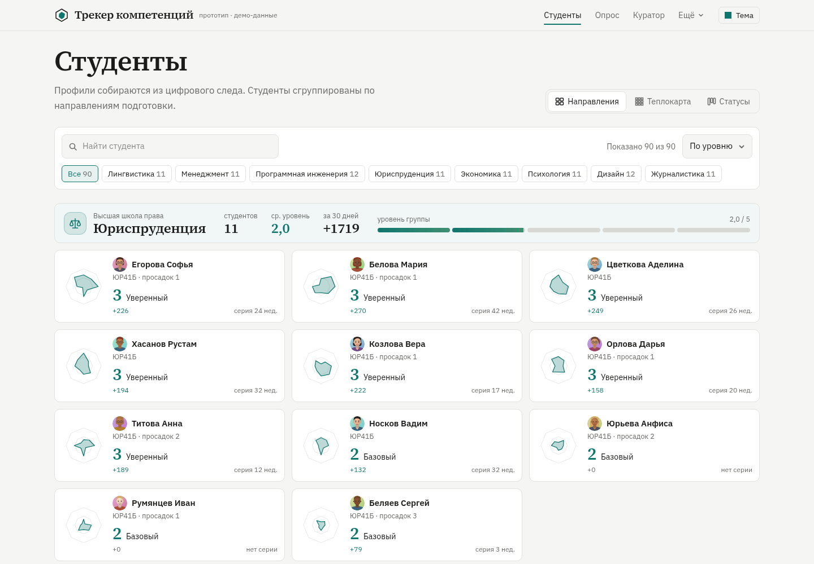

- Студенты сгруппированы по направлениям. Шапка каждого направления: иконка, факультет, число студентов,
  средний уровень, сумма баллов за 30 дней и шкала «уровень группы» из пяти сегментов.
- Ширина блока зависит от числа студентов: 5 и больше занимают всю ширину, 3–4 две трети, 1–2 треть,
  блоки встают рядом, поэтому при поиске не остаётся пустых мест.
- Карточка студента: рисованный аватар, имя, группа, число просадок, уровень, прирост за 30 дней, серия недель
  и мини-радар компетенций.
- Сортировка: по уровню, по росту за 30 дней, по серии, по алфавиту. Список открывается с анимацией,
  работает с клавиатуры (стрелки, Enter, Esc).

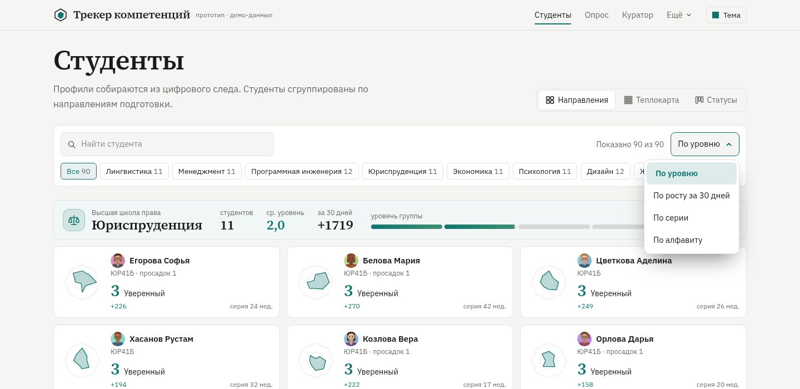

### 1.2 Теплокарта

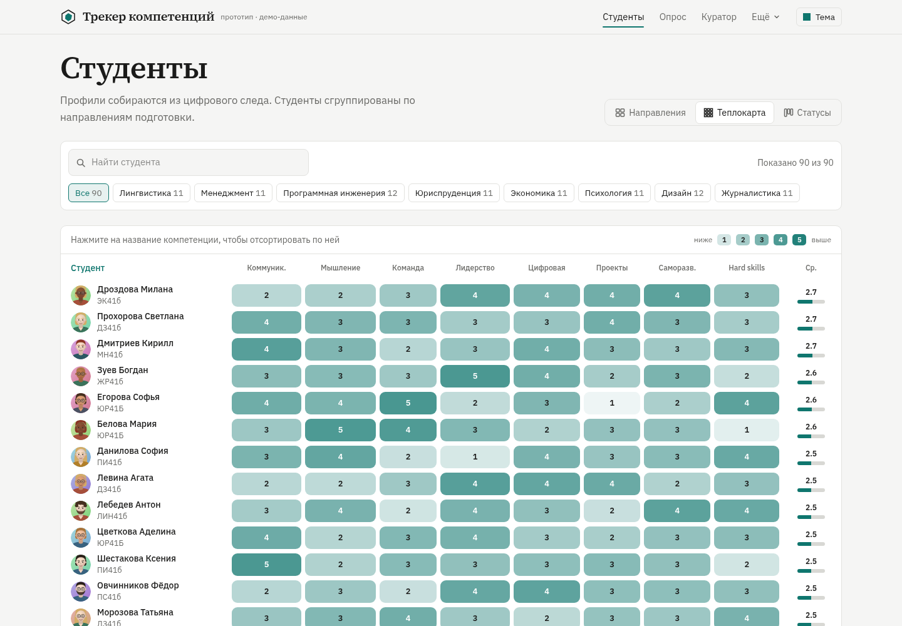

- Таблица «студент × компетенция» с цветовой шкалой от 1 до 5, столбец «Ср.» и среднее по выборке внизу.
- Клик на название компетенции сортирует студентов по ней. На телефоне колонка с именем закреплена слева.

### 1.3 Статусы

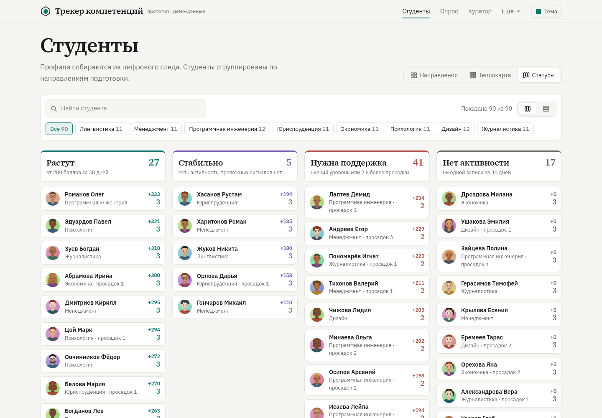

Студенты распределены по статусам:

| Статус | Правило |
|---|---|
| Растут | от 200 баллов за 30 дней и нет тревожных сигналов |
| Стабильно | есть активность, тревожных сигналов нет |
| Нужна поддержка | низкий уровень (средний ниже 1,8) или две и более просадки |
| Нет активности | ни одной записи за 30 дней |

Цвета колонок берутся из выбранного акцента темы со сдвигом оттенка, поэтому различаются на любой теме.
Переключатель раскладки справа в панели: колонками или рядами. В режиме «рядами» ширина блока зависит от числа студентов.

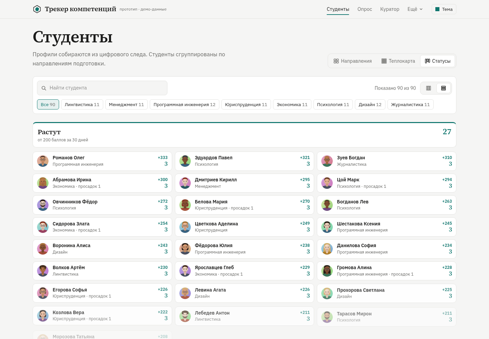

## 2. Профиль студента

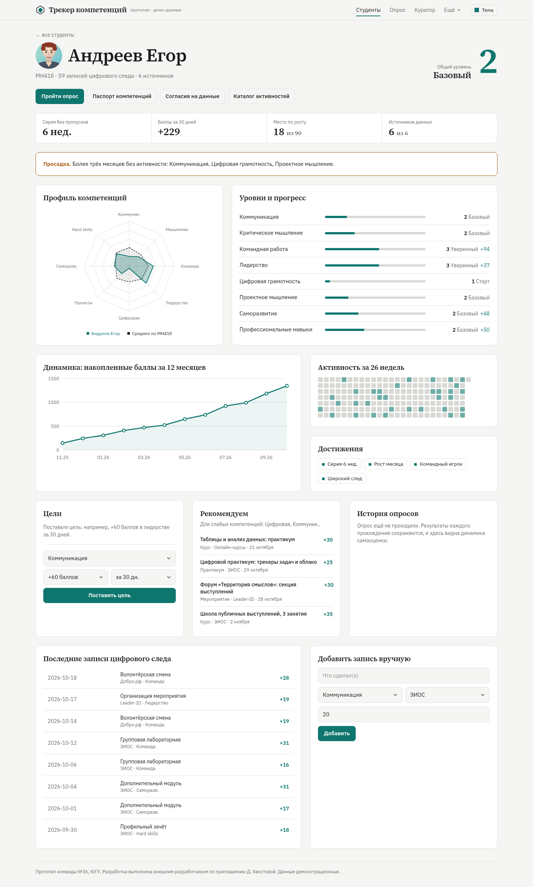

- Крупный рисованный аватар, общий уровень (1–5) с названием, места по росту.
- Радар 8 компетенций со сравнением со средним по группе.
- Список компетенций с уровнем, прогресс-полосой и приростом за 30 дней.
- Динамика накопленных баллов за 12 месяцев, карта активности за 26 недель, достижения.
- Предупреждение о просадке: больше трёх месяцев без активности в компетенции.
- Цели: выбрать компетенцию, число баллов и срок; прогресс считается по записям с даты создания цели.
- Рекомендации по двум слабым компетенциям из каталога активностей.
- История опросов с динамикой самооценки.
- Лента записей цифрового следа и форма ручного добавления.
- Кнопки: пройти опрос, паспорт компетенций, согласия, каталог.

## 3. Панель куратора

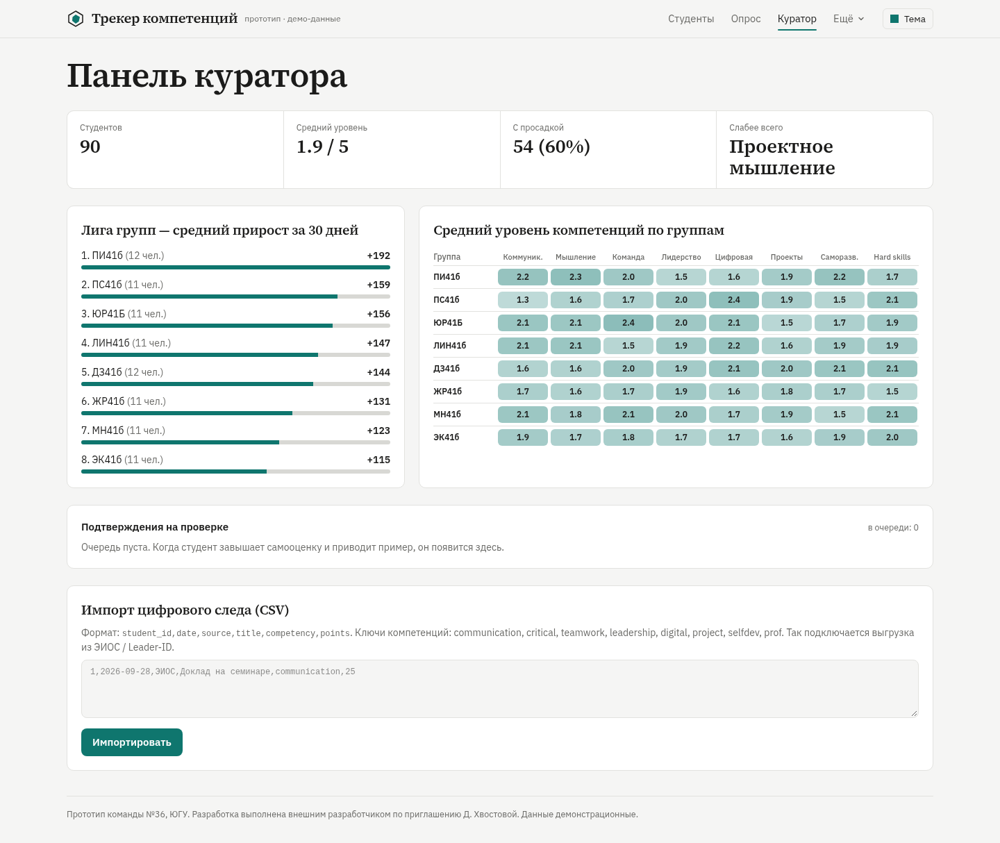

- Показатели: число студентов, средний уровень, доля студентов с просадкой, самая слабая компетенция.
- Лига групп: прирост за 30 дней по группам.
- Средний уровень компетенций по группам.
- Очередь подтверждений: примеры, которыми студенты подтверждают завышенную самооценку; куратор принимает или отклоняет.
- Таблица студентов с фильтром по группе и поиском; импорт цифрового следа из CSV.

## 4. Опрос самооценки

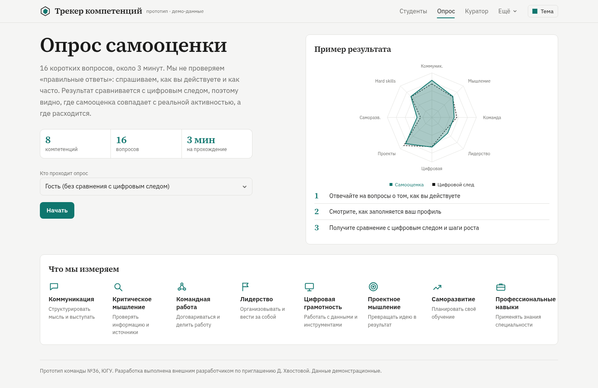

- 16 вопросов о поведении и частоте действий (по два на компетенцию), без «правильных» ответов.
- Варианты ответа без подсказок вроде значков частоты, чтобы не стимулировать завышение.
- После выбора ответа радар достраивается, затем появляется следующий вопрос. Назад вернуться нельзя.
- Результат сверяется с цифровым следом: расхождения подсвечиваются, завышение подтверждается примером и куратором.

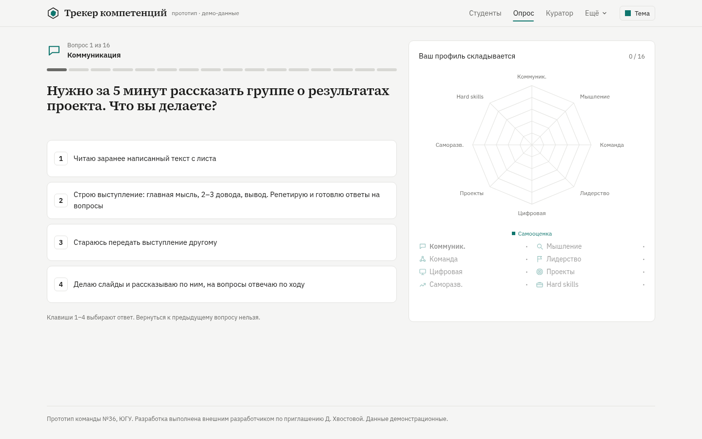

## 5. Центр согласий

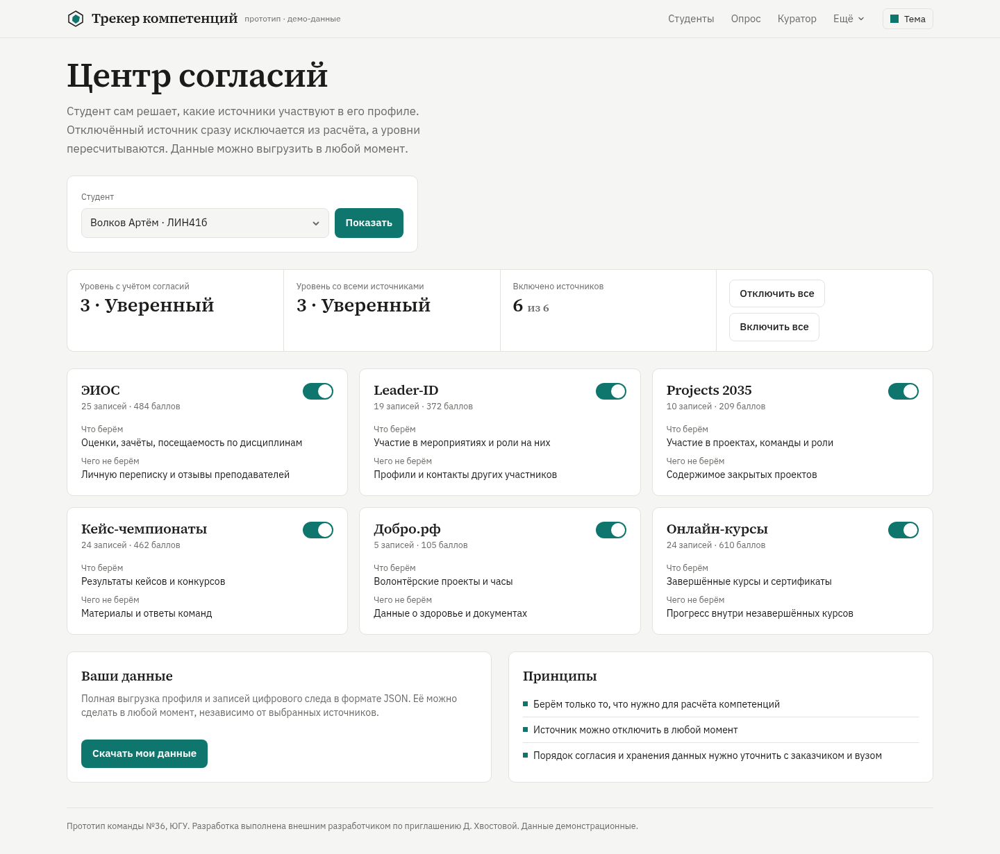

- Для каждого источника данных (ЭИОС, Leader-ID, Projects 2035, кейс-чемпионаты, Добро.рф, онлайн-курсы) написано,
  что берём и чего не берём, сколько записей и баллов.
- Переключатель отключает источник, уровни пересчитываются сразу; показаны уровень с учётом согласий и со всеми источниками.
- Кнопки «Отключить все» и «Включить все».
- Выгрузка всех данных студента в JSON (`/api/export/[id]`).

## 6. Методика

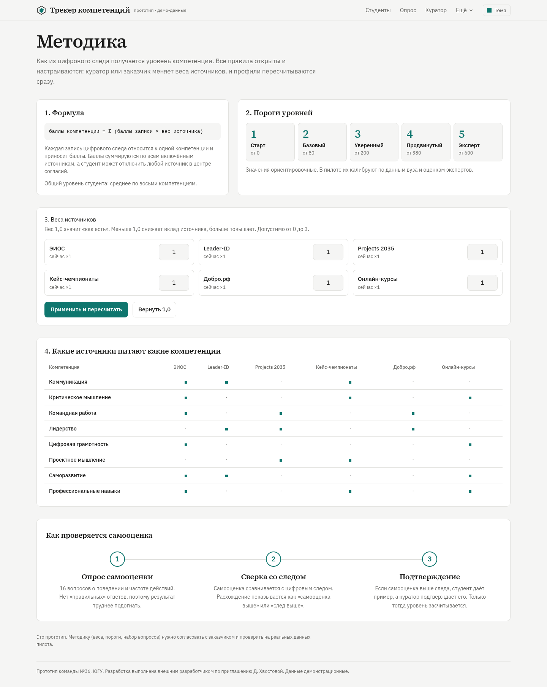

- Формулы: баллы компетенции равны сумме баллов записей с весами источников; пороги уровней.
- Веса источников можно менять от 0 до 3; профили пересчитываются сразу, сброс к значениям по умолчанию.

## 7. Каталог активностей

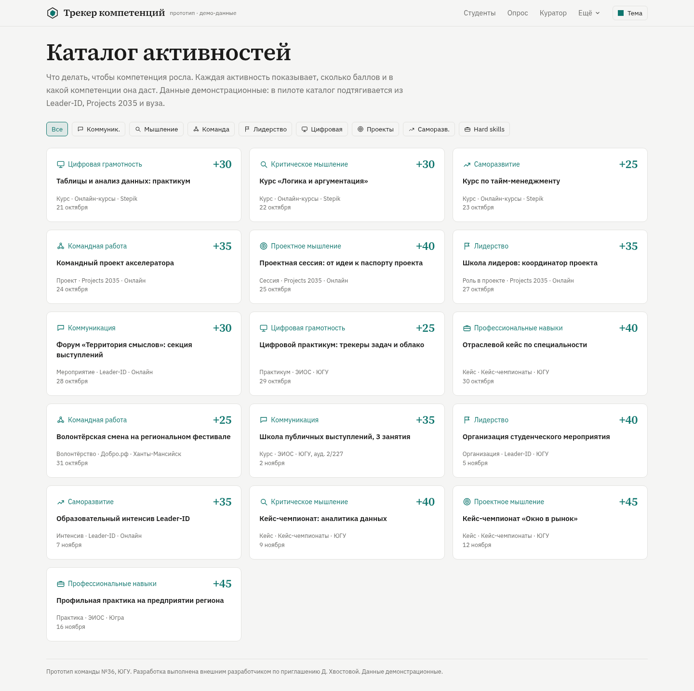

Активности по компетенциям с числом баллов, источником, местом и датой. Фильтр по компетенции со скользящей
подсветкой и плавной сменой карточек.

## 8. Окупаемость

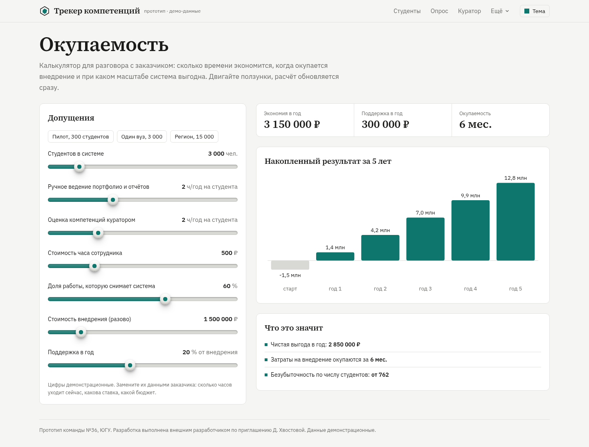

Калькулятор для разговора с заказчиком: число студентов, часы ручной работы и оценки куратором, стоимость часа,
доля работы, которую снимает система, стоимость внедрения и поддержка. Три готовых сценария («пилот», «вуз», «регион»),
экономия в год, окупаемость, график накопленного результата за 5 лет и вывод простыми словами.

## 9. Паспорт компетенций

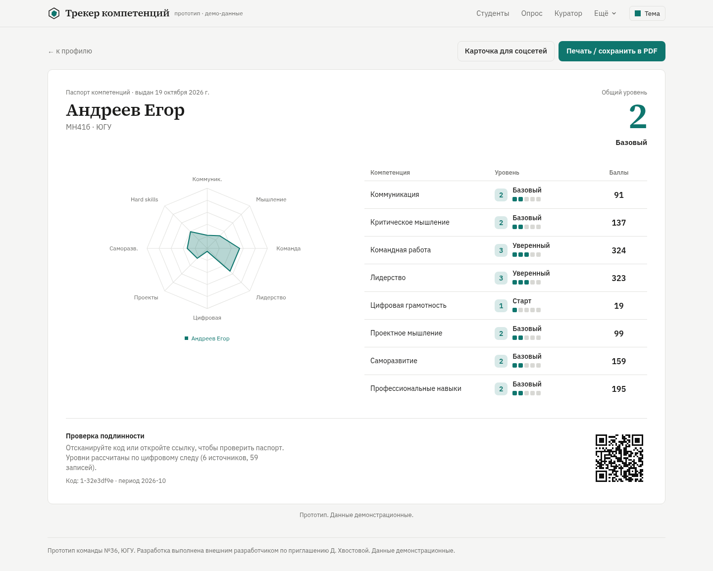

Страница для печати и отправки: компетенции с уровнями, QR-код и ссылка на проверку подлинности (`/verify/[код]`).

## 10. Презентация

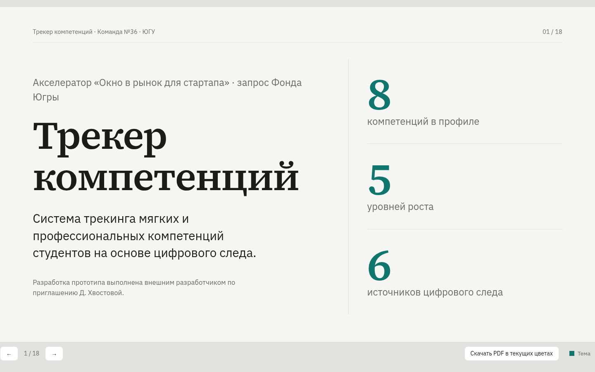

Слайды с живыми страницами прототипа внутри; печать в PDF в цветах выбранной темы. Включает слайд сравнения с аналогами.

## 11. Оформление и движение

- Светлая, тёмная и автоматическая темы, 8 акцентных цветов, плавная смена цветов при переключении.

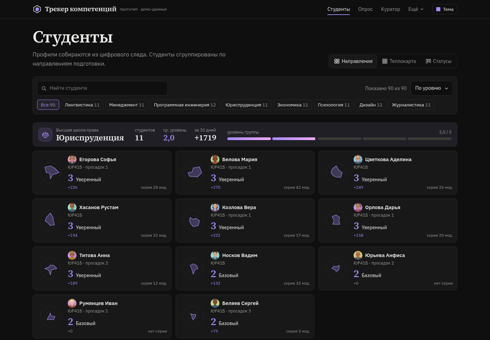
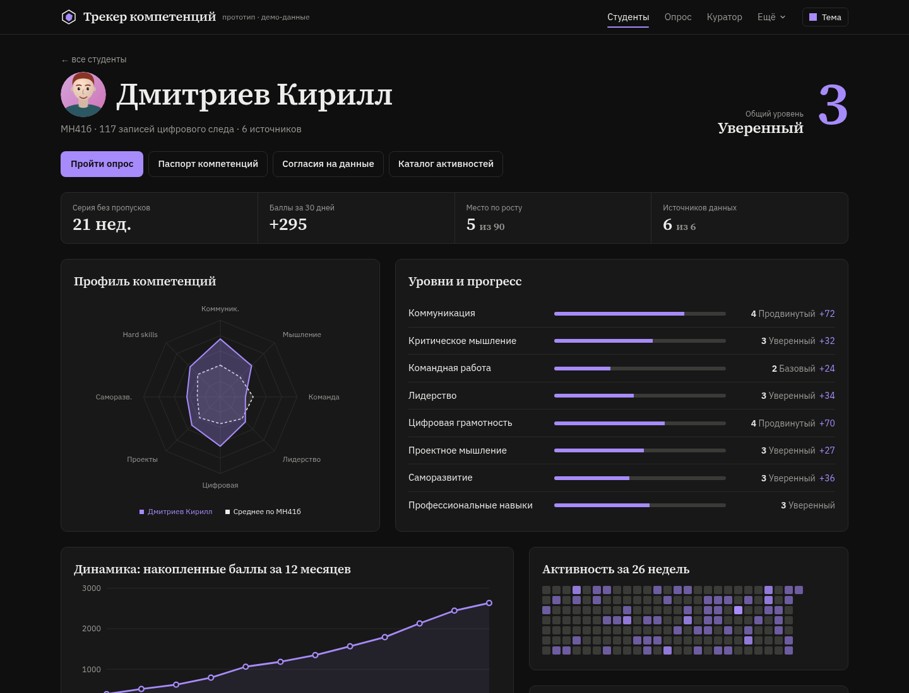

- Плавная прокрутка (Lenis), отключается при настройке «уменьшить анимацию», во встроенных кадрах и в презентации.
- Переходы между страницами (React `ViewTransition`), боковые переходы при смене вида, направления и фильтров.
- Скользящая подсветка в переключателях и в верхней навигации.
- Появление карточек при прокрутке, волна на карте активности, пружинящие ползунки, волна под курсором на кнопках,
  всплывающие подсказки.
- Все анимации отключаются при `prefers-reduced-motion`.

## 12. Телефоны и планшеты

Проверено при ширине 360, 390, 768 и 1024 пикселей: горизонтальной прокрутки нет.

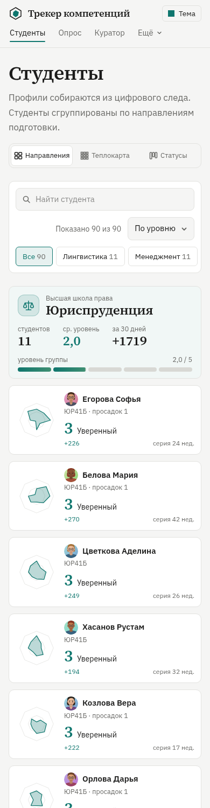
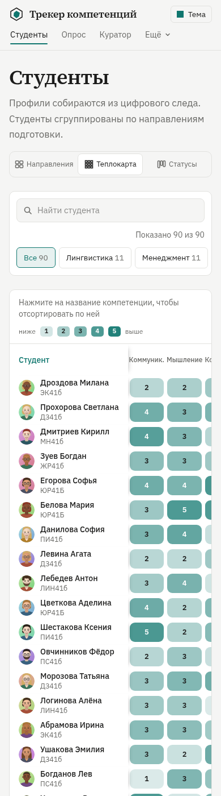
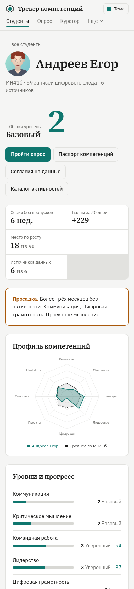
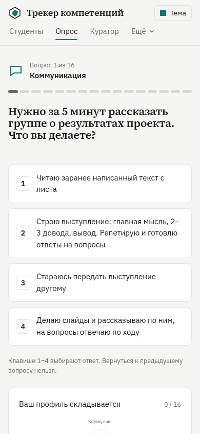

- Переключатель видов на всю ширину; поиск отдельной строкой; кнопки направлений одной лентой, которую можно листать пальцем.
- Теплокарта листается вбок, колонка студента закреплена.
- Плашки с показателями растягиваются без пустых ячеек.
- На устройствах без мыши отключены эффекты наведения.

## 13. Данные и приватность

- 90 вымышленных студентов, 8 направлений, активности за 56 недель. Каждый студент имеет стабильный
  рисованный аватар, который строится из имени локально, без внешних картинок.
- Демо-данные сдвигаются к текущей дате при запуске, поэтому показатели «за 30 дней» остаются актуальными.
- Записи, добавленные вручную, не сдвигаются.
- Согласия студента применяются ко всем расчётам.
- Внешние сервисы не используются, регистрации не нужны.
